# NotEnoughFeatures — project foundations

Status: living architecture brief  
Last updated: 2026-11-01

This document is the compact source of truth for architecture and product decisions.
It is intended for the developer, future contributors, and new Codex chats.

## 1. Product vision

NotEnoughFeatures is a local-first, visual platform for designing, executing, comparing,
and diagnosing reproducible AI/ML experiments.

The platform is responsible for:

- what should be executed;
- with which parameters and data;
- what should be measured;
- where execution occurs;
- which inputs, versions, logs, metrics, and artifacts belong to each result.

The platform does not initially provide compute infrastructure. Execution happens on
the user's machine; a user-managed remote runner may be added later.

The long-term differentiator is not merely a node canvas. It is the complete path:

```text
visual workflow
  -> validated immutable execution plan
  -> matrix of concrete trials
  -> traceable results
  -> comparison and drill-down into failures
```

## 2. MVP scope

### Accepted

The first complete scenario is classical binary classification with stratified
cross-validation:

```text
Tabular Dataset
  -> Target Selection / Dataset Validation
  -> Stratified K-Fold
  -> Model Variants
  -> Train and Predict
  -> Classification Metrics
  -> Results
```

Initial model variants:

- logistic regression;
- random forest.

Initial metrics:

- accuracy;
- F1;
- ROC-AUC;
- confusion matrix as an artifact.

Use the built-in scikit-learn Breast Cancer dataset for deterministic integration tests.
User-provided CSV support is part of the target scenario but should not be the only test
fixture.

### Explicitly deferred

- arbitrary graph cycles;
- deep-learning training;
- image/audio modalities;
- distributed multi-runner scheduling;
- Kubernetes;
- plugin marketplace;
- execution of untrusted plugins;
- autonomous AI-as-a-judge optimization loops;
- comprehensive red teaming;
- collaborative editing.

## 3. Domain terminology

### Accepted hierarchy

The entities are related as follows; this is not a single linear containment chain:



```text
Project
├── Workflow
│   └── WorkflowVersion (immutable snapshot)
└── Experiment (one launch of a WorkflowVersion)
    └── ExecutionPlan (immutable expanded plan owned by the Experiment)
        └── Trial (one fold/model/parameters/seed combination)
            └── NodeRun (execution of one node for this trial)
                └── Attempt (one try, including retries)
```

`Event`, `Artifact`, and `Metric` are records attached to the appropriate entity; they
are not simply the last three levels of the hierarchy.

Definitions:

- **Project** — container for workflows, experiments, data references, and results.
- **Workflow** — editable logical graph.
- **WorkflowVersion** — immutable snapshot of a workflow used for execution.
- **Experiment** — one user-requested launch of a workflow version with runtime options.
- **ExecutionPlan** — concrete, validated plan generated for an experiment.
- **Trial** — one point in the experimental matrix, such as fold 2 + random forest.
- **NodeRun** — execution of one logical node in one trial or shared plan scope.
- **Attempt** — one attempt to execute a NodeRun.
- **Event** — state change, structured log, warning, or progress message.
- **Artifact** — durable output referenced by URI/path and metadata.
- **Metric** — structured measured value with name, value, scope, and optional context.

Open question: some nodes may run once per Experiment rather than once per Trial. The
planner must support shared NodeRuns without duplicating dataset loading and splitting.

## 4. Workflow representation

### Accepted

A saved workflow lists nodes and edges separately. A node instance receives a stable
UUID when placed on the canvas. Moving or renaming the node does not change that UUID.

Every saved workflow includes:

- workflow schema version;
- application compatibility information;
- node instance IDs;
- block type IDs and block implementation versions;
- node configuration;
- UI position and optional grouping information;
- edges between named ports;
- no secret values.

Secrets are represented only by secret references.

An edge connects a specific output port to a specific input port:

```json
{
  "sourceNodeId": "split-1",
  "sourcePort": "training_folds",
  "targetNodeId": "trainer-1",
  "targetPort": "training_data"
}
```

This is necessary because a node can expose different values. A training node may have
`training_data`, `validation_data`, and `estimator` inputs, while producing
`trained_model`, `predictions`, and `training_history`. Connecting nodes without port
names would be ambiguous.

### Edge semantics

For the MVP, an edge represents a data dependency only.

- A single-valued input accepts at most one incoming edge.
- A collection input may accept multiple values, as declared by its port contract.
- Lists are data values or collection ports, not arbitrary arrays stored on edges.
- Conditions should be modeled later through explicit switch/filter/gate blocks.
- Arbitrary executable conditions on edges are deferred because they complicate
  validation, reproducibility, and UI explanation.

## 5. Block contract

Each block definition has four conceptual sections.

### 5.1 General metadata

Information for discovery and presentation, not data compatibility:

- stable block type ID;
- implementation version;
- display name and description;
- category, tags, icon, and documentation link;
- deprecation status;
- implementation/provider identity.

### 5.2 Configuration schema

A JSON Schema-compatible description of user-editable settings, defaults, constraints,
and validation messages. The frontend can generate initial forms from it.

### 5.3 Port contracts

Each named input/output declares:

- base data type;
- cardinality: single or collection;
- required/optional status;
- semantic capabilities or requirements.

### 5.4 Runtime contract

- executor entry point;
- declared outputs;
- resource hints;
- cancellation behavior;
- whether results are cacheable;
- whether durable checkpoints are supported;
- error classification rules.

The backend is the source of truth for validation. Custom frontend code supplied by
plugins is deferred.

## 6. Type system and capabilities

### Accepted approach

Do not maintain a matrix of every allowed block-to-block pair. That would grow as
`O(producers × consumers)` and make plugins tightly coupled.

Instead:

1. An output port describes what it produces.
2. An input port describes what it requires.
3. The validator checks whether the produced contract satisfies the required contract.

Example output:

```json
{
  "type": "dataset",
  "cardinality": "single",
  "capabilities": {
    "modality": "tabular",
    "task": "binary_classification",
    "features": ["numeric"],
    "hasTarget": true
  }
}
```

Example requirement:

```json
{
  "type": "dataset",
  "cardinality": "single",
  "requires": {
    "modality": ["tabular"],
    "task": ["binary_classification", "multiclass_classification"],
    "hasTarget": true
  }
}
```

Initial base types:

- `TabularDataset`;
- `DatasetSchema`;
- `FoldCollection`;
- `TrainTestFold`;
- `ClassifierDefinition`;
- `TrainedClassifier`;
- `Predictions`;
- `ClassificationMetrics`;
- `ArtifactCollection`.

Validation has two levels:

- static validation from block declarations before execution;
- runtime validation using the actual dataset schema and produced values.

Not every incompatibility can be detected statically.

## 7. Multiplicity and graph expansion

### Accepted direction

Individual datasets and models may be represented as individual node instances. The UI
must support bulk creation, so selecting several files can create several dataset nodes
in one action.

A generic `BlockArray` is not automatically a sequence. A collection of models normally
means alternatives that can run in parallel. Execution order is determined by graph
dependencies, not by visual order inside a group.

Recommended UI concepts:

- visual group/frame for organizing many nodes;
- bulk import that creates multiple nodes;
- explicit variant/collection semantics for planner expansion;
- explicit sequential block only when order is genuinely meaningful.

The expansion dimensions are explicit:

```text
datasets × folds × model variants × parameter variants × repetitions
```

The preview must show the number of trials before execution. Estimated duration, memory,
storage, and compute cost are future additions; the plan format should leave room for
resource estimates.

Open question: choose the exact graph representation for variant collections after a
small UI prototype. Do not encode it irreversibly before testing usability.

## 8. Seeds

### Accepted policy

An Experiment can define a global seed. A block-specific seed overrides it.

The system should not blindly pass the identical integer to every stochastic operation.
It should derive stable component seeds from the global seed and stable plan coordinates:

```text
effective seed = explicit block seed
                 or derive(global seed, node ID, fold, repetition, variant)
```

The split seed remains shared across models when models must be compared on exactly the
same folds. Every effective seed is stored in the ExecutionPlan so behavior does not
depend on future changes to the derivation algorithm.

## 9. Compile, preview, and run

### Accepted UX

Use two separate actions rather than a two-position toggle:

1. **Validate and Preview** — validate and create an immutable ExecutionPlan draft.
2. **Run Experiment** — execute exactly the reviewed plan.

The preview includes errors, warnings, informational messages, expansion dimensions,
trial count, and later resource estimates.

If the workflow changes after preview, the plan is invalidated. The Run action must use
the reviewed plan ID/hash so a changed graph cannot execute accidentally.

The compiler should be mostly a pure function:

```python
result = compile_workflow(workflow_version, block_registry, runtime_options)
```

`assert` is a Python statement commonly used in tests to state a condition that must be
true. If false, the test fails with `AssertionError`:

```python
assert len(result.plan.trials) == 10
```

Production input validation should return explicit errors rather than rely on `assert`.

## 10. Lifecycle, failure, retries, and cancellation

### Experiment result states

- `SUCCEEDED` — all required trials succeeded.
- `PARTIALLY_SUCCEEDED` — at least one trial succeeded and at least one failed.
- `FAILED` — no trial produced a valid result.
- `CANCELLED` — user cancellation was completed.

Execution also has transient operational states such as `VALIDATING`, `QUEUED`,
`RUNNING`, and `CANCELLING`.

A process exit code of zero is necessary but not sufficient for success. The runtime
must also verify that declared outputs exist and satisfy their contracts.

When a NodeRun fails:

- dependent downstream NodeRuns become `BLOCKED` or `SKIPPED`;
- independent trials may continue;
- the failed Attempt, logs, partial artifacts, and error classification are preserved.

### Retry policy

Retry count is configurable, but the recommended default is 0 or 1, not 3–5. Most local
ML configuration and code errors are deterministic. Automatic retries are appropriate
for classified transient failures such as network timeouts or temporary remote-service
errors, with bounded exponential backoff.

Never retry validation errors or known deterministic incompatibilities automatically.

### Cancellation

Experiment, Trial, and suitable NodeRun scopes should be cancellable. The worker must
terminate child processes, record cancellation events, and preserve already completed
durable outputs.

## 11. Checkpoints, caching, and resume

### Accepted principle

Resume is based on durable node outputs, not on serializing arbitrary live process
memory.

After a successful NodeRun, its outputs can be persisted as artifacts. A later plan may
reuse them only when a cache key proves equivalence. A cache key should include at least:

- block type and version;
- normalized configuration;
- hashes of all inputs;
- relevant environment/library versions;
- effective seed;
- implementation fingerprint.

Blocks declare whether outputs are:

- durable;
- cacheable;
- checkpointable;
- resumable.

Examples:

- a trained sklearn model can be a durable model artifact;
- transformed data can be a durable dataset artifact;
- an external API call may be non-reproducible but its response can still be recorded;
- an unfinished training process is resumable only if the block explicitly supports
  checkpoints.

Python pickle/joblib model artifacts are version-sensitive and unsafe to load from
untrusted sources. Store library versions and load only artifacts produced by the trusted
local project.

## 12. Dataset identity and storage

SHA-256 is a content fingerprint. The application reads the existing file in chunks and
computes a deterministic digest; this does **not** create a copy and does not require
loading the entire dataset into RAM.

The fingerprint detects:

- whether a file changed at the same path;
- whether two differently named files have identical content;
- whether a cached result still corresponds to the same input bytes.

A reference plus hash does not guarantee future availability. If the original file is
moved or deleted, exact replay becomes impossible.

Recommended storage modes:

- `REFERENCE` — store path/URI, hash, size, schema, and metadata; do not copy;
- `MANAGED_COPY` — optionally copy/import data into project storage for portability;
- later: object storage or remote URI.

MVP default: `REFERENCE`, with a warning when the file is missing or its hash changes.
Managed copying should be opt-in.

## 13. Persistence layout

### Accepted principle

SQLite metadata is the source of truth. Do not make human-readable directory names such
as `Experiment1/Trial2` the primary database because renames, concurrency, partial writes,
and migrations become fragile.

Use stable IDs internally. A possible runtime layout is:

```text
.nef/
├── metadata.db
├── artifacts/
│   └── <content-hash>/...
├── logs/
│   └── <attempt-id>.jsonl
└── temp/
```

The UI may export a human-friendly package:

```text
ProjectName/ExperimentName/TrialName/...
```

but that is an export/view, not internal identity.

## 14. Application form and stack

### Accepted

- Browser UI written in React and TypeScript.
- Python backend using FastAPI and Pydantic.
- pandas and scikit-learn for the first ML scenario.
- Frontend and backend separated at the repository and deployment level.
- Docker Compose may run the services during development and demonstration.

### Container caveat

A browser file picker cannot give a backend container a reusable Windows host path. For
datasets, the product must deliberately choose one of:

- upload bytes to backend-managed storage;
- mount a user directory into the container;
- run a local host agent that can access host paths.

For the MVP, upload/import is simplest for small CSV files; mounted directories can be
documented for larger datasets.

Suggested service evolution:

```text
frontend -> control API -> local worker -> metadata/artifact storage
```

The backend and worker can initially share a codebase. They should have a clear logical
boundary before remote execution is added.

### Tool glossary

- **Vite** — fast development server and build tool for React/TypeScript applications.
- **Tauri** — lightweight desktop shell using the operating system webview and a Rust
  host; useful later for packaging the web UI as a desktop app.
- **Electron** — desktop shell bundling Chromium and Node.js; mature but usually larger
  in memory and package size than Tauri.
- **Polling** — frontend repeatedly requests status, for example every second.
- **SSE** — Server-Sent Events; one long-lived HTTP connection through which the server
  pushes one-way status/log events to the browser.
- **WebSocket** — persistent two-way connection; more flexible but more complex than SSE.
- **Vitest** — fast unit/component test runner for TypeScript and Vite projects.
- **Playwright** — end-to-end browser automation for testing complete user flows.

Recommended start: polling for the first prototype or SSE for live progress; do not add
WebSockets until two-way real-time communication is actually required.

## 15. Repository structure

### Near-term recommendation

```text
NotEnoughFeatures/
├── frontend/                  # React/TypeScript UI
├── backend/                   # FastAPI, compiler, registry, execution
│   ├── app/
│   │   ├── api/
│   │   ├── domain/
│   │   ├── workflows/
│   │   ├── execution/
│   │   └── builtin/
│   └── tests/
├── docs/
│   ├── PROJECT_FOUNDATIONS.md
│   ├── decisions/
│   └── diagrams/
├── tests/
│   └── fixtures/              # cross-service workflow JSON fixtures
├── compose.yaml
└── README.md
```

`packages/` would contain reusable source-code packages, schemas, or generated clients;
it is not intended for saved workflow/plugin snapshots. It is unnecessary until real
shared packages exist.

`tests/` contains test code and controlled input fixtures, not user experiment results.
Runtime results belong in a gitignored data directory or mounted Docker volume.

Use `backend/app/builtin/` for built-in block implementations. Reserve a top-level
`plugins/` directory only when an external plugin contract is implemented.

## 16. Architecture decisions and visual documentation

### Accepted documentation policy

- This file is the readable architectural overview and glossary.
- Fundamental decisions may receive small Markdown ADRs in `docs/decisions/`.
- Maintain an index rather than expecting readers to scan dozens of files.
- Store diagrams as editable text/native sources (`.mmd`, `.excalidraw`) plus rendered
  SVG/PNG when useful.
- Link images from Markdown with relative paths.
- Avoid `.doc`/`.docx` as the source of truth because binary changes are hard to diff,
  review, search, and merge.

Not every minor choice needs an ADR. Use one when a decision is costly to reverse or when
future contributors are likely to ask why an alternative was rejected.

## 17. First two-week milestone

The milestone is complete when the system can:

1. display a small classification workflow on a canvas;
2. configure the required MVP blocks;
3. save and load workflow JSON;
4. connect named compatible ports;
5. reject cycles and clear incompatibilities;
6. validate a workflow;
7. compile 5 folds × 2 model variants into 10 Trials;
8. display the reviewed ExecutionPlan before execution;
9. invalidate that plan if the Workflow changes;
10. pass compiler unit tests for valid and invalid fixtures.

Real model training may begin in the following milestone. The compiler, not visual polish,
is the core proof of the first two weeks.

## 18. Open decisions

- Exact UI representation for model/dataset variant collections.
- Exact first block list and whether target selection is part of dataset configuration or
  a separate block.
- Exact type/capability vocabulary and matching rules.
- Whether initial development uses upload-only datasets or Docker directory mounts too.
- SQLite schema and artifact-store interface.
- Whether the first implementation uses polling or SSE.
- Exact retry classification and configurable upper limits.
- Whether workflow configuration schemas are shared with the frontend as JSON Schema or
  generated from Pydantic models.

These should be resolved through small executable prototypes and recorded here.

## 19. Workflow contract prototype (2026-11-01)

### Implemented scope

The initial backend slice supports editable workflow JSON, a versioned built-in block
registry and static validation through FastAPI. It deliberately stops before compilation
into an ExecutionPlan, persistence, data access, trial expansion and execution. A valid
graph means its declarations are compatible, not that its data or execution is valid.

The example declares the built-in Breast Cancer dataset, target selection, five
stratified folds, logistic regression and random forest definitions, train/predict,
classification metrics and a results sink. Nodes carry stable UUIDs and UI positions.
No metrics or execution results are fabricated. Each block advertises
`executionSupported: false`; runtime contracts are still to be implemented.

### Prototype recommendations — not final decisions

These choices exercise the Open items above and remain replaceable after a UI prototype:

- Use a separate Target Selection / Dataset Validation block. Its declared guarantees
  are runtime obligations; the current validator does not inspect target columns,
  feature dtypes, class counts or fold feasibility.
- Represent model alternatives as individual classifier nodes connected to the
  `estimators` collection input of Train and Predict. This does not finalize general
  variant-collection representation, expansion rules or shared NodeRun scheduling.
- Generate configuration JSON Schema from Pydantic models and serve it with the block
  catalog. Keep configuration validation on the backend.
- Start with exact base-type equality. An input capability scalar requires exact
  equality; a list declares allowed values. Every producer value must be accepted.
  Unknown/missing capabilities fail rather than being assumed compatible. Initial keys
  are `modality`, `features`, `task`, `hasTarget` and `probabilities`.
- A single output can feed a collection input, as can an output collection of the same
  base type. These inputs aggregate element values without nesting. A collection
  output cannot feed a single input. A required input needs a connection and cannot
  rely on an optional output; non-empty runtime collections need future value checks.

The existing Open decisions remain Open. The next compiler slice should establish a
reviewable preview for 5 folds × 2 models = 10 trials, including immutable snapshot/plan
identity and invalidation on edits. The validation endpoint does not implement the
complete **Validate and Preview** action yet.
